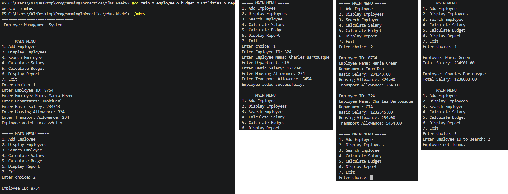
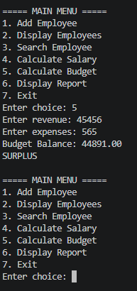
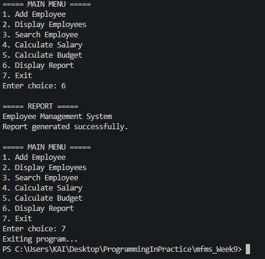

# MFMS – Week 9 Laboratory
## Modular Multi-File Application

### 1. Project Description

This project is the Week 9 modular version of the MFMS (Management and Financial Management System). The application was reorganised into separate C source and header files to improve code structure, readability and maintainability.

### 2. Project Modules

| File | Description |
|---|---|
| `main.c` | Controls the main menu and application flow. |
| `employees.c / employees.h` | Contains employee-related functions. |
| `budget.c / budget.h` | Contains budget-related functions. |
| `utilities.c / utilities.h` | Contains reusable input and helper functions. |
| `reports.c / reports.h` | Contains reporting functions. |

### 3. Compilation and Execution

Compile each source file separately:

```bash
gcc -std=c99 -Wall -Wextra -pedantic -c main.c
gcc -std=c99 -Wall -Wextra -pedantic -c employees.c
gcc -std=c99 -Wall -Wextra -pedantic -c budget.c
gcc -std=c99 -Wall -Wextra -pedantic -c utilities.c
gcc -std=c99 -Wall -Wextra -pedantic -c reports.c
```

Link all object files:

```bash
gcc main.o employees.o budget.o utilities.o reports.o -o mfms
```

Run the application:

```bash
./mfms
```

### 4. Testing Evidence

The application was successfully compiled, linked and tested. No compilation, linker or runtime errors were encountered.

#### Test 1 – Employee Management

Test employee management functionality, such as adding and viewing employee records.



#### Test 2 – Budget Management

Test budget functionality, calculating the budget.



#### Test 3 – Reports and Main Menu

Test the reporting functionality and verify that the main menu allows navigation between options and exits correctly.



### 5. Conclusion

The MFMS application was successfully modularised into separate source and header files. All modules compiled and linked successfully, and the application executed as expected. The project meets the Week 9 laboratory requirements.
